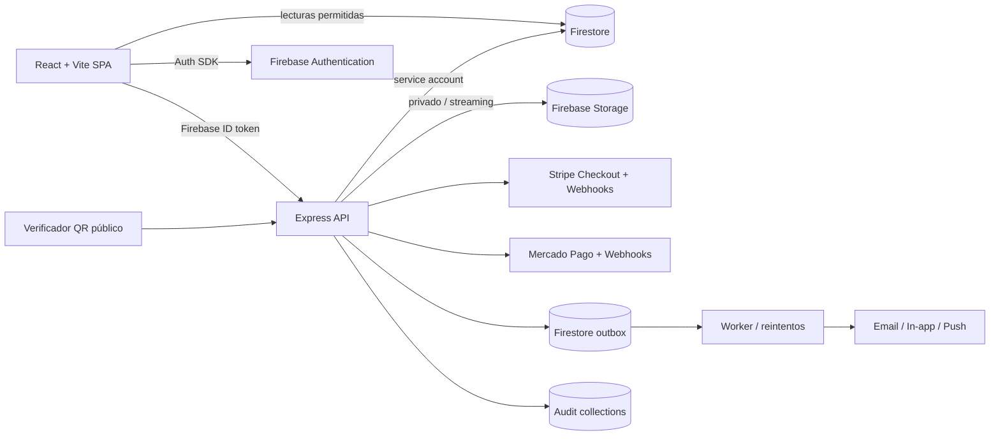

# KIRA 2.1 — inventario, coherencia y roadmap de arquitectura

**Base observada:** React 19 + Vite 6, Express/Node, Firebase Authentication, Firestore REST y Firebase Storage. No existe PostgreSQL como base primaria; los esquemas SQL del documento de requisitos se traducen a colecciones Firestore. Este documento describe el estado de la rama de auditoría, no certifica que producción esté desplegada.

## 1. Inventario de módulos

| Módulo | ¿Existe? | Dependencias | Estado observado | Prioridad |
|---|---|---|---|---|
| Auth & Identity | Sí | — | Parcial: Firebase Auth y validación JWT; MFA obligatorio, rotación de sesión y recuperación integral por validar | P0 |
| Users & Roles (RBAC/ABAC) | Sí | Auth | Parcial: roles y permisos de staff; controles homogéneos por recurso/API aún incompletos | P0 |
| Courses & Content | Sí | Users | Parcial: cursos, contenidos y publicación; versionado y límites de media pendientes | P0 |
| Enrollment & Progress | Sí | Courses, Payments | Parcial: matrículas/progreso; reglas de finalización y pago deben quedar centralizadas | P0 |
| Coaching Sessions | Sí | Users, Courses | Parcial: agenda/sesiones; asistencia y proveedor de videollamada requieren pruebas | P1 |
| Payments & Billing | Sí | Users, Courses, Enrollment | Parcial: checkout Stripe/Mercado Pago y webhooks entrantes; esta rama añade configuración, planes, cupones y auditoría en Firestore; refunds, facturas, dunning y payouts no completos | P0 |
| Certificates | Sí, en rama | Enrollment, Users, Payments | Parcial: PDF A4, HMAC, QR, verificación, revocación y activos privados implementados en rama; faltan pruebas end-to-end y validación de pago/matrícula en todos los escenarios | P0 |
| Notifications | Sí | Todos | Parcial: notificaciones in-app; email/push, plantillas y outbox pendientes | P1 |
| Storage & Media | Sí | Auth | Parcial: Firebase Storage y reglas privadas; antivirus/cuarentena y políticas de retención pendientes | P0 |
| Verification pública | Sí | Certificates | Parcial: endpoint /api/verify y página pública; pruebas de revocación, firma alterada y privacidad pendientes | P0 |
| Analytics & Reports | Sí | Todos | Parcial: dashboards; métricas reconciliadas con ledger aún no garantizadas | P1 |
| Audit & Compliance | Sí | Todos | Parcial: auditLogs, certificate_audit y paymentAudit/config_audit; exportación/retención centralizadas pendientes | P0 |
| Configuration Center | Parcial | Todos | Parcial: settings dispersos; se añade configuración de pagos con versión/auditoría; feature flags y rollback general pendientes | P1 |
| Support / Ticketing | Parcial | Users, Notifications | Parcial: accesos/vistas de soporte; ciclo completo de tickets, SLA y adjuntos por validar | P1 |
| Webhooks & Integrations | Sí, parcial | Payments, Courses | Parcial: webhooks entrantes firmados; outbox y webhooks salientes firmados/reintentos pendientes | P0 |
| Invoices & Tax | No completo | Payments | Faltante: facturación fiscal, numeración, impuestos y documentos por país | P1 |
| Refunds & Disputes | No completo | Payments, Audit | Faltante/parcial: proceso de reembolso conciliado y disputas | P0 |
| Payouts / Coach settlements | Parcial | Payments, Users | Parcial: panel de liquidación; transferencia real y conciliación bancaria no demostradas | P1 |
| Search & Discovery | Parcial | Courses, Books | Parcial: listados/catálogos; búsqueda indexada y permisos de contenido por probar | P2 |

**Criterio de estado:** “existe” significa que hay código, ruta, colección o UI en el repositorio. “Completo” exigiría pruebas integradas y evidencia operacional; no se marca ningún módulo completo solo por existir una pantalla.

## 2. Arquitectura de contenedores

El cliente nunca calcula importes confiables, emite certificados, habilita matrículas ni marca pagos como pagados. Firestore y Storage tienen reglas restrictivas; el servidor aplica autorización adicional y utiliza credenciales de servicio.

## 3. Modelo de datos Firestore equivalente

| Colección | Documento/clave | Contenido principal |
|---|---|---|
| paymentSettings | global | paymentsEnabled, baseCurrency, allowedCurrencies, roundingRule, requirePayment, updatedBy, updatedAt |
| paymentGateways | stripe / mercadopago / paypal / manual | enabled, mode, priority, publicKey, apiKeyEncrypted, webhookSecretEncrypted |
| paymentPlans | ID aleatorio | name, amountCents, currency, interval, trialDays, courseId, status |
| paymentCoupons | código normalizado | code, type, value, maxUses, usedCount, expiresAt, status |
| orders | ID aleatorio | userId, items, amount, currency, provider, status, provider reference |
| paymentEvents | ID de evento | provider, providerEventId, processedAt, outcome |
| paymentAudit | ID aleatorio | actorId, action, entity, before, after, ip, userAgent, createdAt |
| config_audit | ID aleatorio | scope, key, actorId, before, after, createdAt |
| certificates | KIRA number | snapshot alumno/curso/coach/admin, horas, assets, HMAC, PDF, estado |
| certificatePublic | KIRA number | proyección mínima pública de validación |
| certificate_audit | ID de evento | emisión/revocación, actor, IP, user-agent, timestamp |
| outbox | ID de evento | type, payload, status, attempts, nextAttemptAt |

No usar IDs de usuario PostgreSQL: las referencias deben guardar Firebase Auth UID. Los snapshots de certificado conservan el nombre y curso emitidos aunque se editen después.

## 4. Reglas de consistencia y contratos de eventos

| Evento | Productor | Consumidores | Invariante |
|---|---|---|---|
| user.created | Auth | Notifications, Analytics, Audit | UID estable |
| course.published | Courses | Search, Notifications | solo admin publica |
| payment.paid | Webhook/Payments | Enrollment, Notifications, Audit | firma verificada + monto/moneda/orden coincidentes + idempotencia |
| enrollment.completed | Enrollment | Certificates, Analytics | progreso completado y pago verificado cuando corresponda |
| certificate.issued | Certificates | Verification, Analytics, Notifications | snapshot firmado e inmutable |
| payment.refunded | Payments | Enrollment, Certificates, Notifications | política decide suspensión/revocación; todo queda auditado |
| config.updated | Configuration | módulos consumidores | versión y auditoría, invalidación de caché |
| certificate.revoked | Certificates | Verification, Notifications, Audit | verificador devuelve revoked |

### Reglas obligatorias

1. El servidor valida la matrícula del alumno y su estado completed antes de emitir.
2. Si el curso/plan requiere pago, debe existir pago paid conciliado con la orden y el mismo usuario.
3. El certificado conserva snapshots y solo se revoca mediante API autorizada.
4. El navegador no escribe directamente en orders, paymentGateways, paymentSettings, paymentPlans, paymentCoupons ni colecciones de auditoría.
5. Desactivar checkout global o una pasarela impide crear nuevas sesiones; no altera pagos confirmados.
6. Archivar un plan impide nuevas compras, sin modificar órdenes ya pagadas.
7. Cada webhook usa la firma del proveedor y su identificador de evento para evitar doble procesamiento.
8. Los reembolsos no se deben marcar como exitosos hasta confirmación del proveedor.

## 5. Seguridad transversal — baseline ASVS L2

| Control | Estado de rama | Evidencia/próxima validación |
|---|---|---|
| Autenticación de API | Parcial | Firebase ID token verificado; probar expiración, issuer, audience y revocación |
| RBAC/ABAC server-side | Parcial | requireSuperAdmin en pagos; revisar cada endpoint y propiedad/tenant |
| MFA admin | Pendiente de evidencia | exigir MFA por política y bloquear acciones privilegiadas sin segundo factor |
| Cifrado de secretos | Parcial | AES-256-GCM para secretos de gateway; KIRA_CONFIG_ENCRYPTION_KEY solo en entorno servidor |
| TLS/HSTS/CORS | Pendiente de revisión global | verificar middleware y headers en deployment |
| Webhooks | Parcial | Stripe signature y Mercado Pago HMAC; agregar tolerancia temporal, idempotencia persistente y pruebas replay |
| Rate limiting | Parcial | emisión de certificados tiene límite en memoria; usar almacenamiento compartido para multi-instancia |
| Auditoría | Parcial | eventos de certificados y pagos; centralizar, exportar y definir retención |
| Storage privado | Parcial | reglas privadas para firmas/PDF; validar MIME por contenido y análisis antivirus |
| XSS/HTML/PDF | Pendiente de pruebas | sanitizar texto y validar nombres/curso en PDF |
| PCI DSS SAQ-A | Objetivo | checkout hospedado por gateway; nunca recibir ni almacenar PAN/CVV |
| Backups/restore | Sin evidencia | backup cifrado y restauración ensayada |
| SAST/SCA | Parcial | pipeline y Dependabot/Semgrep deben quedar verdes |

No declarar ASVS L2 ≥90 % hasta completar una matriz de controles con evidencia de test por requisito.

## 6. Variables de entorno de servidor

- `FIREBASE_SERVICE_ACCOUNT_JSON`: cuenta de servicio Firebase para Firestore/Storage.
- `KIRA_CONFIG_ENCRYPTION_KEY`: clave AES-256 de 32 bytes en base64 o 64 caracteres hex; exclusiva del servidor.
- `KIRA_CERTIFICATE_SIGNING_SECRET`: HMAC de certificados, mínimo 32 caracteres.
- `KIRA_APP_URL`: URL canónica.
- `STRIPE_SECRET_KEY`, `STRIPE_WEBHOOK_SECRET`, `MERCADOPAGO_ACCESS_TOKEN`, `MERCADOPAGO_WEBHOOK_SECRET`: fallback de transición; preferir credenciales cifradas del Centro de Pagos.
- `FIREBASE_STORAGE_BUCKET`: bucket real.

No guardar claves KMS/JWT/Redis/DB_URL como si KIRA tuviera PostgreSQL/Redis. Si se adopta KMS administrado, Redis o cola externa en otra fase, documentar el servicio real y su provisioning.

## 7. Plan de pruebas

- Unitarias: AES-GCM (roundtrip/tampering), cálculo de importes, cupones, normalización de moneda, HMAC de certificado.
- Integración: Firestore Emulator para permisos; checkout con claves de prueba; Stripe/Mercado Pago webhook válido, inválido, repetido, fuera de ventana y monto incorrecto.
- Contrato: OpenAPI para API de pagos/configuración y respuestas sin secretos.
- E2E: admin configura gateway y plan → alumno compra → webhook confirma → matrícula activa → alumno completa → admin emite → QR valida → revocación visible.
- Seguridad: acceso directo a colecciones denegado, enumeración de IDs, rate limit distribuido, replay, privilege escalation, IDOR y carga de archivos falsificados.
- Carga: k6 para checkout, verificación QR, lecturas del panel y ráfagas de webhook.
- Regresión: comprobar login, alumno, coach, dashboard y rutas existentes antes de fusionar.

## 8. Roadmap

| Fase | Alcance | Gate de salida |
|---|---|---|
| F0 | Auth, roles, settings base, auditoría | reglas probadas y MFA admin |
| F1 | Courses, Enrollment, Storage | matrícula completada consistente |
| F2 | Pasarelas, planes, checkout, webhooks | pago sandbox + producción conciliado, refunds |
| F3 | Certificates + Verification | emisión real, QR, PDF, revocación E2E |
| F4 | Coaching + Notifications | sesiones y entrega con reintentos |
| F5 | Analytics, Audit, Support, Integrations | reconciliación, exportación y operación |

## 9. Limitaciones pendientes específicas del código actual

- Las credenciales de pasarelas se pueden guardar cifradas desde el Centro de Pagos, pero todavía se debe validar en un entorno seguro el despliegue de `KIRA_CONFIG_ENCRYPTION_KEY`.
- La integración de suscripciones recurrentes, refunds, impuestos, facturas fiscales, payouts y dunning no se considera terminada.
- El webhook/outbox saliente y el worker durable no están implementados por este cambio.
- La rotación de claves cifradas y el versionado/rollback general de configuración requieren una fase adicional.
- El checkout de Mercado Pago no acepta planes recurrentes en esta implementación.
- La prueba final depende de CI verde, Firebase Emulator y credenciales de sandbox; no ejecutar migraciones ni cambios en producción desde esta rama.

