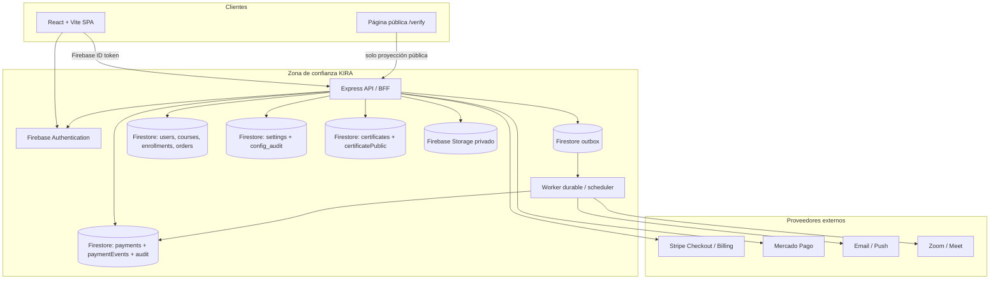
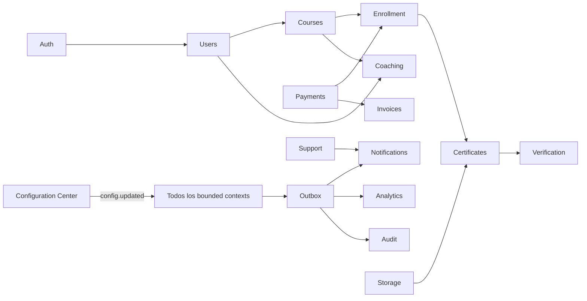

# KIRA 2.1 — Blueprint ejecutable de arquitectura, seguridad y coherencia

**Fecha:** 2026-11-08  
**Rama:** `audit/kira-real-modules-security-commerce`  
**Stack verificado:** React 19 + Vite 6 + Express/Node + Firebase Authentication + Firestore REST + Firebase Storage.  
**Estado:** diseño y brechas de la rama auditada; no equivale a despliegue ni a certificación de producción.

## 0. Decisiones no negociables

1. Firestore sigue siendo la fuente de verdad. No se introducen migraciones PostgreSQL ficticias ni se duplican usuarios/matrículas en otra base.
2. El navegador no determina importes, estados de pago, elegibilidad de certificados ni roles privilegiados.
3. Las credenciales privadas se descifran únicamente en Express. La clave de cifrado vive fuera de Firestore y del repositorio.
4. Las operaciones críticas deben ser idempotentes y atómicas. Si una operación necesita leer, validar y escribir varias entidades, se usa transacción Firestore; un batch no reemplaza una transacción de lectura-modificación-escritura.
5. Los módulos se comunican por contratos/eventos. No se permite que Payments invoque lógica interna de Certificates.
6. Ninguna funcionalidad se considera completa solo porque exista una pantalla o ruta. Requiere pruebas de integración/E2E y evidencia de operación.
7. No se promueve a `main` ni a `kira.coach` hasta disponer de preview del SHA exacto, pruebas y aprobación explícita.

## 1. Inventario real y faltantes

| Módulo | ¿Existe? | Dependencias | Estado observado | Prioridad |
|---|---|---|---|---|
| Auth & Identity | Sí | — | Parcial: Firebase Auth y verificación de ID token; MFA obligatorio, recuperación, revocación y rotación de sesiones deben demostrarse | P0 |
| Users & Roles | Sí | Auth | Parcial: perfiles y roles; matriz uniforme RBAC/ABAC, MFA y separación tenant aún incompletas | P0 |
| Courses & Content | Sí | Users | Parcial: cursos, publicación y contenido; versionado, permisos por material y límites de carga pendientes | P0 |
| Enrollment & Progress | Sí | Courses, Payments | Parcial: progreso y matrículas; invariantes de finalización/pago no están centralizadas ni transaccionales | P0 |
| Coaching Sessions | Sí | Users, Courses | Parcial: sesiones/calendario; asistencia, cancelación, zona horaria y video requieren pruebas | P1 |
| Payments & Billing | Sí | Users, Courses, Enrollment | Parcial: checkout Stripe/MP, webhooks y panel básico; reembolsos, disputas, impuestos, facturas fiscales, dunning y suscripciones completas faltan | P0 |
| Certificates | Sí | Enrollment, Users, Payments | Parcial: PDF A4, snapshot, HMAC/QR, verificación y revocación; idempotencia de emisión, settings.requirePayment y E2E integral pendientes | P0 |
| Notifications | Sí | Todos | Parcial: in-app; correo, push, plantillas, preferencias y outbox durable faltan | P1 |
| Storage & Media | Sí | Auth | Parcial: Storage privado para activos de certificado; cuarentena antivirus, validación MIME por contenido, signed URL y retención faltan | P0 |
| Verification pública | Sí | Certificates | Parcial: endpoints/página pública; pruebas de privacidad, manipulación, revocación y rate limit pendientes | P0 |
| Analytics & Reports | Sí | Todos | Parcial: paneles; conciliación con ledger, definiciones KPI y exportación controlada pendientes | P1 |
| Audit & Compliance | Sí | Todos | Parcial: auditLogs, certificate_audit, paymentAudit/config_audit; retención, exportación, integridad y centralización faltan | P0 |
| Configuration Center | Parcial | Todos | Parcial: configuración de pagos inicial; settings tipados globales, feature flags, versiones y rollback genérico faltan | P0 |
| Support / Ticketing | Parcial | Users, Notifications | Parcial: vistas/soporte básico; ciclo de ticket, SLA, adjuntos y permisos completos no demostrados | P1 |
| Webhooks & Integrations | Parcial | Payments, Courses | Parcial: webhooks entrantes; outbox, webhooks salientes firmados, reintentos y API keys faltan | P0 |
| Invoices & Tax | No | Payments | Faltante: numeración, impuestos por jurisdicción, plantilla y cumplimiento fiscal local | P1 |
| Refunds & Disputes | Parcial | Payments, Audit | Faltante crítico: endpoint/flujo reconciliado, aprobaciones, política y disputa | P0 |
| Payouts / Coach settlements | Parcial | Payments, Users | Panel/registro parcial; transferencia real, KYC y conciliación no demostrados | P1 |
| Subscription Lifecycle | Parcial | Payments, Enrollment | Parcial: creación de checkout recurrente; ciclo de renovación, cancelación, impago y sincronización de entitlement incompletos | P0 |
| Outbox / Jobs | No completo | Todos | Faltante: worker durable, leases, backoff, DLQ y replay seguro | P0 |
| Secrets & Key Lifecycle | Parcial | Config, Payments, Certificates | AES-GCM implementado; KMS, rotación, key ID, rotación de HMAC y recuperación de claves pendientes | P0 |
| Privacy / LGPD | Parcial | Users, Audit, Storage | Faltante: inventario PII, exportación, anonimización/borrado legal, retención y legal hold | P1 |
| Search & Discovery | Parcial | Courses, Books | Parcial: listados; índice, búsqueda y filtros con autorización pendientes | P2 |

**Prioridad:** P0 bloquea el lanzamiento con dinero/certificados; P1 es necesario para operación sostenible después del MVP controlado; P2 mejora escalabilidad y descubrimiento.

### Hallazgos concretos del código auditado

- `fulfillOrder()` consulta el pedido, verifica estado y luego hace un batch de escrituras. Dos webhooks concurrentes pueden superar la lectura inicial; hace falta una transacción Firestore con precondición de estado y clave idempotente por proveedor/evento.
- La activación de matrícula usa `course.price` como criterio, mientras que el panel expone `paymentSettings.requirePayment`. Debe existir una única política server-side que resuelva curso, plan y override; no dos reglas distintas.
- La emisión verifica `enrollment.completed || enrollment.courseCompleted || progress >= 100` y, para cursos con precio positivo, `paymentStatus === paid`. Debe comprobar además la política efectiva de pago, la relación exacta con el order/payment y un estado canónico `completed`.
- El rate limit de emisión está en memoria de proceso; no es válido como control distribuido en varias instancias.
- La configuración de pagos existente cubre Stripe y Mercado Pago. PayPal, pagos manuales, refunds, impuestos, invoices, payouts y dunning no deben presentarse como disponibles.
- La UI actual ofrece modo `test/live`, planes y cupones; no demuestra rollback de configuración, editor de impuestos, reembolsos ni conciliación de suscripciones.
- El modelo de secretos AES-GCM requiere comprobar que `KIRA_CONFIG_ENCRYPTION_KEY` está provisionada en cada entorno; nunca se debe usar un fallback inseguro.
- Los tests actuales de reglas prueban acceso denegado a colecciones de pagos. No prueban por sí solos transacciones de pagos ni integraciones de proveedor.

## 2. Arquitectura C4 — contenedores



**Límites de confianza:** browser no confiable; API Express como punto de enforcement; Firebase Admin/service account solo en servidor; proveedores externos autenticados por firma; verificación pública recibe únicamente una proyección mínima sin PII adicional.

## 3. Modelo de datos Firestore (migraciones equivalentes)

No se ejecuta SQL en esta arquitectura. Las siguientes colecciones y campos son el contrato objetivo. Crear documentos con IDs deterministas cuando la idempotencia lo requiera; usar UID Firebase como FK lógica. Crear índices compuestos en `firestore.indexes.json` según consultas reales.

| Colección | ID / clave | Campos mínimos y restricciones |
|---|---|---|
| users | Firebase UID | role, approvalStatus, email; cambios de rol solo servidor |
| courses | courseId | status, coachId, price, currency, requiresPayment, version |
| enrollments | enrollmentId | userId, courseId, status, progress, paymentOrderId, paymentStatus, completedAt, version |
| orders | orderId | userId, itemSnapshots[], amountMinor, currency, provider, status, idempotencyKey, createdAt |
| paymentTransactions | provider_payment_id | orderId, provider, amountMinor, currency, status, verifiedAt |
| paymentEvents | provider_event_id | provider, eventId, payloadHash, receivedAt, processedAt, outcome |
| paymentSettings | global | paymentsEnabled, baseCurrency, allowedCurrencies, roundingRule, requirePayment, version |
| paymentGateways | provider | enabled, mode, priority, publicKey, encryptedCredentials, keyVersion, updatedAt |
| paymentPlans | planId | name, courseId?, amountMinor, currency, interval, trialDays, status, version |
| paymentCoupons | normalized_code | type, value, maxUses, usedCount, expiresAt, status, version |
| paymentRefunds | refundId | orderId, providerRefundId, amountMinor, reason, status, requestedBy, approvedBy |
| invoices | invoiceId | orderId, sequence, jurisdiction, taxSnapshot, totals, documentPath, status |
| subscriptions | provider_subscription_id | userId, planSnapshot, status, currentPeriodStart/End, cancelAtPeriodEnd |
| configSettings | scope_key | typed value, schemaVersion, version, updatedBy, updatedAt |
| config_audit | auditId | scope, key, before, after, versionBefore, versionAfter, actorId, requestId |
| paymentAudit | auditId | actorId, action, entity, entityId, redacted before/after, requestId |
| certificates | kiraNumber | student/course/coach/admin snapshots, enrollmentId, paymentRef, academicHours, asset hashes, signature, status |
| certificatePublic | kiraNumber | status, courseName, student display policy, issuedAt, signature verification metadata only |
| certificate_audit | auditId | kiraNumber, action, actorId, requestId, timestamp |
| outbox | eventId | aggregate, aggregateId, type, schemaVersion, payload, status, attempts, nextAttemptAt, leaseUntil |
| webhookSubscriptions | subscriptionId | endpoint, eventTypes, secretCiphertext, enabled, retryPolicy |
| webhookDeliveries | deliveryId | eventId, endpointId, attempt, statusCode, responseHash, nextAttemptAt |
| supportTickets | ticketId | ownerUid, assignedUid, status, priority, category, timestamps |
| mediaObjects | objectId | ownerUid, storagePath, detectedMime, size, scanStatus, retentionUntil |

### Contratos de estados

- Order: `created → pending → paid | failed | cancelled | expired`; después de `paid`, solo refunds/disputes cambian el estado financiero.
- Payment: `pending → succeeded | failed`; refund es entidad/ledger aparte: `requested → pending_provider → succeeded | failed`.
- Enrollment: `pending_payment → active → in_progress → completed`; puede pasar a `suspended` o `revoked` por política y auditoría.
- Certificate: `issued → revoked`; no editar snapshot firmado. Correcciones generan nueva emisión/reemplazo vinculado.
- Subscription: `incomplete → active → past_due → canceled | unpaid`; el entitlement depende del estado de suscripción y período pagado.
- Coupon: `active → exhausted | expired | disabled`; el conteo de uso se incrementa transaccionalmente al reservar/confirmar el descuento.

### Transacciones e idempotencia

- Crear checkout: UUID idempotency key por intención de compra; el servidor resuelve plan/precio/moneda y guarda snapshot inmutable.
- Confirmar webhook: transacción Firestore lee evento, orden y entitlements; si evento ya procesado devuelve éxito idempotente; verifica proveedor, monto, moneda, usuario y referencia; cambia order y payment; crea enrollment/entitlement y outbox en la misma transacción.
- Emisión: transacción comprueba enrollment completed, pago requerido satisfecho y ausencia de certificado activo; reserva KIRA number/idempotency key; guarda snapshot y audit. La generación PDF/Storage ocurre en job idempotente; el certificado no se marca descargable hasta que PDF y QR estén guardados.
- Cupón: reserva/incrementa usos dentro de transacción; no confiar en contador de UI.
- Refund: primero crear refund solicitado; llamar proveedor con idempotency key; webhook/consulta del proveedor confirma; solo entonces registrar éxito y aplicar política de entitlement.
- No ejecutar llamadas de red externas dentro de una transacción Firestore.

## 4. Dependencias, eventos y consistencia



| Evento versionado | Productor | Consumidores | Condición de publicación |
|---|---|---|---|
| user.created.v1 | Identity | Notifications, Analytics, Audit | usuario confirmado |
| course.published.v1 | Courses | Search, Notifications | publicación autorizada |
| checkout.created.v1 | Payments | Audit, Analytics | orden pendiente creada |
| payment.succeeded.v1 | Payments | Enrollment, Invoice, Notifications, Audit | webhook validado + transacción confirmada |
| payment.refunded.v1 | Payments | Enrollment, Certificates, Notifications, Audit | proveedor confirma refund |
| enrollment.completed.v1 | Enrollment | Certificates, Analytics, Notifications | progreso y requisitos validados |
| certificate.issued.v1 | Certificates | Verification, Analytics, Notifications, Audit | PDF/QR y snapshot persistidos |
| certificate.revoked.v1 | Certificates | Verification, Notifications, Audit | revocación autorizada |
| config.updated.v1 | Configuration | módulos suscritos | versión guardada y auditada |
| webhook.delivery.requested.v1 | Outbox | Webhook dispatcher | evento elegible |

**Reglas invariantes**

1. No hay certificado sin enrollment del mismo alumno/curso y estado `completed`.
2. Si la política efectiva `enrollment.requirePayment` es true para el curso/plan, debe existir pago `succeeded` asociado a la misma orden, usuario, producto, importe y moneda.
3. El certificado congela identidad visible, título/versión del curso, coach, horas, fecha, firmas y hashes de activos.
4. La pasarela desactivada no crea nuevos checkouts; no invalida pagos ya confirmados.
5. Archivar un plan impide compras nuevas; suscripciones activas conservan snapshot y derechos hasta el fin del período pagado.
6. Un coach solo puede firmar/autorizar los cursos que tiene asignados; la firma debe existir y su hash se incluye en el snapshot.
7. Reembolso confirmado aplica la política versionada `revokeOnRefund`; nunca se revoca por un refund meramente solicitado.
8. Notificación, analytics y webhooks salientes se publican por outbox, no como efectos secundarios no recuperables.
9. Cada consumidor mantiene deduplicación por `eventId`; los eventos llevan `schemaVersion`, `occurredAt`, `aggregateId` y `correlationId`.
10. Los módulos no importan repositorios/servicios privados de otro bounded context; usan contratos de aplicación/eventos.

## 5. Payments: configuración Superadmin

### Alcance editable previsto y estado actual

| Capacidad | Configuración persistida | UI/API actual | Estado |
|---|---|---|---|
| Stripe / Mercado Pago | enabled, mode, priority, public key, secretos cifrados | Sí | Parcial; verificar sandbox/live con secretos reales |
| PayPal / manual | provider config, validación, conciliación | No operativo | No habilitar |
| Moneda y redondeo | base, allowed, rounding | Sí | Parcial; FX y reglas por curso faltan |
| Planes/precios | amountMinor, currency, interval, trial, courseId | CRUD parcial | Parcial; versionado y suscripciones lifecycle |
| Cupones | tipo, valor, límites, expiración | crear/listar parcial | Parcial; consumo transaccional en checkout no demostrado |
| Impuestos | país/región, tasa, inclusivo, tax ID | No | Faltante P1 |
| Facturas | serie, numeración, plantilla, emisor | No | Faltante P1; revisar legislación local |
| Refunds/disputes | ventana, máximo, aprobación, provider ref | No | Faltante P0 |
| Payouts | schedule, cuenta destino, umbral | No real | Faltante P1 |
| Webhooks salientes | endpoint, eventos, secreto, retries | No | Faltante P0 |
| Dunning | retries, intervalos, emails | No | Faltante P1 |
| Auditoría/rollback | before/after, actor, version, reason | audit parcial | Rollback no implementado |

### API objetivo (REST)

Las rutas existentes se preservan como compatibilidad temporal; las nuevas rutas se versionan bajo `/api/v1`.

| Método | Ruta | Permiso | Estado |
|---|---|---|---|
| GET | /api/admin/payments/settings | payments.read | existe con ruta legacy config |
| PATCH | /api/admin/payments/settings/:key | superadmin + config.write | falta |
| GET | /api/admin/payments/gateways | payments.read | falta ruta separada; config aggregate existe |
| POST | /api/admin/payments/gateways | superadmin | falta (proveedores allowlist) |
| PATCH | /api/admin/payments/gateways/:id | superadmin | adaptar PUT actual |
| GET/POST | /api/admin/payments/plans | read/write | POST + aggregate read existen |
| PATCH | /api/admin/payments/plans/:id | superadmin | existe |
| DELETE | /api/admin/payments/plans/:id | superadmin | usar soft archive, no hard delete |
| GET/POST | /api/admin/payments/coupons | read/write | POST + aggregate read existen |
| POST | /api/admin/payments/refunds | payments.refund.request | falta |
| GET | /api/admin/payments/audit | payments.audit.read | existe |
| POST | /api/webhooks/:provider | proveedor | existen endpoints Stripe y MP separados |
| POST | /api/payments/checkout | alumno | existe checkout legacy; normalizar contrato |

### Reglas de pagos

- Importes en enteros de unidad mínima (`amountMinor`); no floats monetarios.
- No almacenar PAN/CVV; utilizar checkout hospedado/tokenización del proveedor. Objetivo PCI DSS SAQ-A sujeto a validación del adquirente/proveedor.
- AES-256-GCM con IV aleatorio de 96 bits, auth tag, key version y AAD (provider + record ID + field). Rotación y KMS son requisitos P0 antes de producción.
- Nunca devolver ciphertext ni secretos; devolver `configured: true` y `masked: ••••1234` si el formato permite mostrar últimos caracteres de forma segura. No registrar secretos en logs ni audit diff.
- Webhooks Stripe: verificar raw body con SDK oficial y firma del proveedor.
- Mercado Pago: validar x-signature/manifest con tolerancia y consultar el pago al API oficial antes de fulfillment. Persistir event ID y payload hash para deduplicación.
- Idempotencia de checkout y refunds obligatoria; rechazar claves repetidas con payload distinto.
- `payments.enabled=false` desactiva nuevas sesiones; mantener acceso ya pagado.
- No declarar pagos recurrentes listos hasta cubrir invoice/subscription events, retries, cancelación, prorrateo y entitlement.

## 6. Configuration Center global

### Contrato de setting

```ts
type ConfigSetting<T> = {
  key: string;
  scope: "global" | "course" | "role" | "tenant";
  value: T;
  valueType: "boolean" | "string" | "number" | "enum" | "json";
  schemaVersion: number;
  version: number;
  updatedBy: string;
  updatedAt: string;
};
```

Cada escritura debe validar con Zod en Express, comparar `expectedVersion` (optimistic concurrency), escribir nuevo valor + config_audit en una transacción, y emitir `config.updated.v1` en outbox. Rollback no borra el historial: crea una nueva versión cuyo valor proviene de una versión anterior, registra actor, motivo y referencia de rollback.

### Settings por módulo

| Módulo | Keys iniciales |
|---|---|
| Auth | auth.session.ttl, auth.mfa.requiredRoles, auth.password.minLength |
| Courses | courses.maxLessons, courses.allowedMime, courses.maxUploadBytes |
| Enrollment | enrollment.requirePayment, enrollment.autoApprove, enrollment.accessTtlDays, enrollment.prerequisites |
| Coaching | coaching.defaultDuration, coaching.timezone, coaching.videoProvider |
| Certificates | certificates.enabled, certificates.minHours, certificates.templateVersion, certificates.brandingAssetPath |
| Notifications | notifications.email.enabled, notifications.sender, notifications.templates |
| Storage | storage.maxBytes, storage.allowedMime, storage.quarantine.enabled, storage.retentionDays |
| Analytics | analytics.retentionDays, analytics.export.enabled |
| Payments | payments.enabled, payments.baseCurrency, payments.allowedCurrencies, payments.revokeOnRefund |
| Support | support.enabled, support.slaHours, support.attachmentMaxBytes |

No permitir que un setting cambie permisos o active un proveedor sin validación de seguridad y auditoría reforzada.

## 7. UI Superadmin — contrato funcional

La UI React/Tailwind existente `AdminPaymentsConfig.tsx` ya ofrece toggles, modo test/live, prioridad, credenciales, planes, cupones y lectura de auditoría. No se declara completa: no ofrece rollback, refunds, taxes, invoices, payouts, dunning ni webhooks salientes.

La siguiente iteración UI debe incluir:

- Banner persistente cuando cualquier gateway habilitado esté en modo test; distinguirlo de live.
- Formulario de plan con validación de moneda, entero minor units, intervalo, curso y trial.
- Vista de secretos solo como estado configurado/máscara; nunca volver a mostrar valor original.
- Historial before/after redactado, actor, fecha, request ID y motivo.
- Acción rollback que requiere confirmar versión objetivo, motivo, MFA reciente y expectedVersion.
- Acción de refund separada: importe máximo calculado en servidor, confirmación explícita y doble aprobación según umbral.
- Bloqueo de botón y feedback accesible mientras hay operaciones; nunca asumir éxito antes de respuesta API.
- Mostrar estados de webhook/health y fecha de último evento válido, sin exponer payload sensible.

## 8. Seguridad transversal — STRIDE / OWASP ASVS L2

| Área / amenaza | Controles requeridos | Estado evidenciado |
|---|---|---|
| Spoofing | Firebase token verify, MFA admin, session revocation | Parcial |
| Tampering | validación Zod, snapshots firmados, transacciones, reglas deny-by-default | Parcial |
| Repudiation | audit inmutable, requestId, actor, timestamps y exportación | Parcial |
| Information disclosure | least privilege, PII minimizada, Storage privado, secretos redactados | Parcial |
| Denial of service | rate limit distribuido, cuotas, payload caps, webhook backoff | Parcial |
| Elevation of privilege | RBAC+ABAC server-side, MFA, separación superadmin | Parcial |
| API1 Broken Object Level Authorization | ownership/tenant/course policy en cada endpoint | No verificado |
| API2 Broken Authentication | MFA, refresh/session revocation | No verificado |
| API3 Broken Object Property Level Authorization | allowlists de campos, DTOs | Parcial |
| API4 Unrestricted Resource Consumption | rate limits, límites de upload y paginación | Parcial |
| API5 Broken Function Level Authorization | permisos por acción, no solo rol de UI | Parcial |
| API6 Sensitive Business Flows | antifraude, idempotencia, límites y detección de abuso | Parcial |
| API7 SSRF | allowlist de URL para webhooks y egress control | Pendiente |
| API8 Security Misconfiguration | headers, CORS, HSTS, CSP, env separation | Pendiente de evidencia |
| API9 Improper Inventory Management | OpenAPI versionada, inventario de endpoints | Parcial |
| API10 Unsafe Consumption of APIs | validar respuesta/proveedor, timeouts, TLS | Parcial |

### Controles mínimos por capa

- Auth: MFA obligatorio superadmin/admin; tokens de corta duración; revocación y reautenticación para operaciones de riesgo.
- API: middleware común de identidad + permiso + ownership; Zod strict; no confiar en rol enviado por cliente.
- Firestore: deny-by-default para ledger, config, certificados y roles; reglas explícitas por colección; pruebas emulator para allow y deny.
- Storage: paths separados public/private/quarantine; validar MIME real y tamaño; antivirus antes de publicar; signed URLs cortas y no indexables.
- QR: token aleatorio no enumerable + HMAC-SHA256 sobre canonical JSON; comparación timing-safe; rotación con key ID; endpoint público con rate limit y respuesta mínima.
- Pagos: firma proveedor, timestamp, idempotencia, conciliación de amount/currency/order/user, sin PAN/CVV.
- Auditoría: redacción de PII/secretos, append-only, request/correlation IDs, retención y exportación.
- Infra: TLS 1.2+, HSTS, CSP, CORS allowlist, backups cifrados, restauración mensual, secretos distintos por entorno.
- Supply chain: SAST Semgrep, Dependabot/SCA, lockfile, SBOM y artefactos firmados antes de lanzamiento.

**No se afirma ASVS L2 ≥90 %.** La cobertura solo puede calcularse tras mapear cada requisito ASVS aplicable a evidencia, test automatizado/manual, responsable y fecha. La rama actual tiene controles parciales, no una certificación ASVS.

## 9. Variables de entorno mínimas reales

| Variable | Uso | Secreto |
|---|---|---|
| FIREBASE_SERVICE_ACCOUNT_JSON | identidad server-side Firestore/Storage | Sí |
| KIRA_CONFIG_ENCRYPTION_KEY | AES-256-GCM para credenciales gateway | Sí, alta entropía |
| KIRA_CERTIFICATE_SIGNING_SECRET | HMAC de certificados | Sí, alta entropía |
| KIRA_APP_URL | origen QR/redirect | No |
| FIREBASE_STORAGE_BUCKET | bucket de activos privados | No |
| STRIPE_SECRET_KEY / STRIPE_WEBHOOK_SECRET | fallback de transición; preferir secret cifrado en config | Sí |
| MERCADOPAGO_ACCESS_TOKEN / MERCADOPAGO_WEBHOOK_SECRET | fallback de transición; preferir secret cifrado en config | Sí |

`DB_URL`, `REDIS_URL`, `JWT_SECRET` y `KMS_KEY` no son variables operativas del stack actual. No agregarlas hasta adoptar esos servicios. Para rate limit y cola distribuida, elegir y provisionar Redis/Cloud Tasks/PubSub con ADR antes de introducir variables.

## 10. Plan de pruebas y gates

| Tipo | Casos obligatorios | Gate |
|---|---|---|
| Unit | money minor units, coupon limits, AES-GCM tampering/key rotation, HMAC canonicalization, state machines | 100% de invariantes críticas |
| Firestore rules | alumno/coach/admin/superadmin, ledger read/write, certificate request, storage access | todos los allow/deny esperados |
| Integration | webhook válido/inválido/replay/duplicado, importe/moneda/user mismatch, checkout desactivado | sin doble entitlement |
| Transaction race | dos eventos simultáneos mismo order, cupón último uso, doble emisión | exactamente un resultado |
| Contract | OpenAPI schemas, secret redaction, status codes, event schemas | compatibilidad versionada |
| E2E | admin configura test gateway → alumno checkout → webhook → enrollment → completion → certificate → QR → revoke | recorrido íntegro sandbox |
| Refund E2E | refund solicitado → proveedor confirma → ledger → entitlement policy → certificate policy | sin revocación prematura |
| Security | IDOR, BOLA, privilege escalation, replay, XSS, SSRF, file spoofing, rate limit | cero hallazgos críticos/altos abiertos |
| Load (k6) | checkout, QR verify, dashboard, webhook bursts | SLO definidos y sin duplicados |
| Recovery | backup restore, replay outbox, key rotation | runbook ejecutado con evidencia |

### Criterios de salida de lanzamiento

- CI verde en el SHA candidato.
- Preview Vercel READY para ese SHA exacto.
- Secretos y assets reales provisionados desde panel seguro de entorno.
- Stripe y Mercado Pago sandbox E2E completos; luego prueba controlada live de importe mínimo.
- Certificado emitido, PDF recuperable, QR válido y revocación visible.
- MFA de administradores, reglas Firestore y Storage verificadas.
- No existen fallos P0/P1 críticos abiertos.
- Backup/restore y rollback documentados.
- Aprobación explícita del propietario para merge/promoción.

## 11. Roadmap

| Fase | Módulos | Entregable / gate |
|---|---|---|
| F0 — seguridad base | Auth, Users/RBAC, Config Center, Audit, Secrets | MFA, permisos uniformes, settings versionados, rollback probado |
| F1 — dominio académico | Courses, Enrollment, Storage | matrícula y progreso con invariantes y reglas |
| F2 — monetización | Payments, Plans, Coupons, Webhooks, Refunds | checkout, webhook, conciliación, refund sandbox |
| F3 — certificación | Certificates, Verification | emisión transaccional, PDF, QR, revocación E2E |
| F4 — experiencia | Coaching, Notifications, Support | asistencia, emails y tickets con outbox |
| F5 — operación | Analytics, Invoices/Tax, Payouts, Integrations, Compliance | conciliación, exportación, retención y runbooks |

## 12. Decisiones y limitaciones

- No convertir KIRA a PostgreSQL por cumplir un ejemplo SQL: duplicaría identidades y rompería la coherencia con Firebase Auth/Firestore.
- No prometer “100 % editable” hoy: el panel de pagos cubre solo parte de las opciones. El objetivo requiere desarrollar submódulos y contratos faltantes.
- No declarar certificados listos para producción: el endpoint ya valida matrícula, curso, coach, pago y activos privados, pero falta alinear el flag `requirePayment`, transacciones/idempotencia y pruebas E2E.
- No declarar ASVS L2 90 %: falta matriz de evidencia.
- No activar PayPal/manual, refunds, tax, payouts, dunning o webhook saliente sin implementación y pruebas.
- Este blueprint no cambia la rama productiva ni configura secretos reales.
